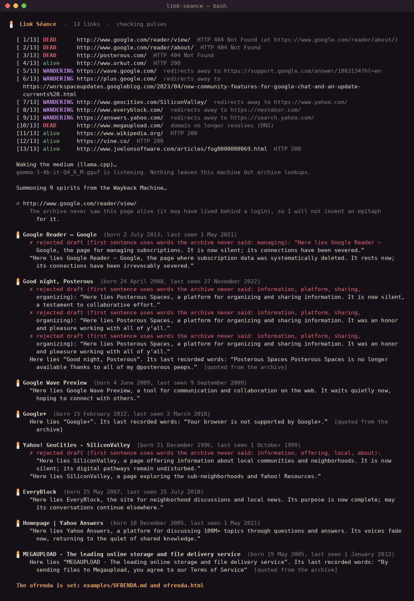

# 🕯️ Link Séance

**Find the dead links in a list, summon their last snapshot from the Internet Archive, and let a small open-weight model running on your own machine write each one an epitaph.**

Give it an old bookmarks export, a README, or a blog post. It checks every link's pulse, asks the Wayback Machine when each lost page was last seen as itself, reads what the archive kept, and lets a local Gemma model write a two-line epitaph from those words and nothing else. The results are laid out on an ofrenda: `OFRENDA.md` for your repo, and `ofrenda.html`, a small candle-lit page you can open in any browser.



> Built for the DEV Hacktoberfest Open-Source AI Challenge, Week 4: *Ghost in the Machine*.

---

## Why

A lot of the web many of us grew up on is gone: Orkut scrapbooks, Posterous blogs, the Google Reader tab that was always open. Link rot isn't spooky because pages vanish. It's spooky because they vanish *quietly*, and a list of links slowly turns into a list of ghosts.

Link Séance is a small way of honouring them. And it's built so that it can't vanish like they did: no account, no API key, no cloud model. A Python file, a model file, and the Internet Archive.

## Quick start

```bash
git clone https://github.com/cryptocloud786/link-seance && cd link-seance
pip install -r requirements.txt          # just llama-cpp-python

# an open-weight Gemma 3 model in GGUF form (no Hugging Face login needed for these builds)
mkdir -p models
curl -L -o models/gemma-3-4b-it-Q4_K_M.gguf \
  https://huggingface.co/ggml-org/gemma-3-4b-it-GGUF/resolve/main/gemma-3-4b-it-Q4_K_M.gguf
# or the 1B model (800 MB), much faster, plainer epitaphs:
# https://huggingface.co/ggml-org/gemma-3-1b-it-GGUF/resolve/main/gemma-3-1b-it-Q4_K_M.gguf

python link_seance.py examples/bookmarks-2009.md --model models/gemma-3-4b-it-Q4_K_M.gguf -o my-ofrenda
```

Already use Ollama? Skip `llama-cpp-python` and run:

```bash
ollama pull gemma3:4b
python link_seance.py my-links.md --backend ollama --model gemma3:4b
```

Input can be plain text, Markdown, or a browser's `bookmarks.html` export. Any `http(s)://` URL it finds is checked.

| Option | What it does |
|---|---|
| `-o DIR` | where to write `OFRENDA.md`, `ofrenda.html`, `ofrenda.json` |
| `--model` | path to a `.gguf` file (llama.cpp) or a model tag (Ollama). Defaults to the first file in `./models/` |
| `--backend` | `llama.cpp` (default) or `ollama` |
| `--offline` | replay a séance entirely from the local cache, with no network at all |
| `--no-model` | skip the model and quote the archive directly |
| `--threads N` | CPU threads for llama.cpp |

## How it works

**1. Checking pulses.** Every link is fetched, following redirects the way a browser would. Each one comes back as one of three things (a link that is only rate-limiting us is marked `unknown` and left alone):

- `alive`: it answers on its own address.
- `DEAD`: the domain no longer resolves, the TLS is broken, or the server says 404/410/5xx.
- `WANDERING`: it answers, but only by redirecting you somewhere else, usually a shutdown notice or the company that swallowed it. (GeoCities sends you to Yahoo. EveryBlock sends you to Nextdoor. Yahoo Answers sends you to Yahoo Search.)

**2. Summoning.** For each dead or wandering link it asks the Wayback Machine's CDX API for one capture per month. The newest capture is often a tombstone: an error page, a parking page, or the redirect target itself. So Link Séance binary-searches the timeline for the last month the page was still *itself*, then reads that snapshot's own text (title, description, visible words) with the Wayback toolbar stripped out. If the CDX API is unavailable it falls back to the public availability API.

That search gets the dates right on its own: Megaupload's last living capture is January 2012 (it was seized on 19 January 2012), and Yahoo Answers' is May 2021 (it shut down that month).

**3. The medium.** A local Gemma 3 model (via llama.cpp or Ollama) is given the archived text and asked for two sentences: what the page was, then a farewell. It doesn't get to say just anything. Each draft is checked before it is allowed on the ofrenda:

- **No invented names or numbers.** Every proper noun and number must appear in the archived text.
- **The first sentence must be built from the archive's own words.** At least 60% of its content words (beyond the page's title) must appear in the snapshot.
- **No first person.** The page's ghost doesn't get to speak as "we".

If a draft fails, the model is told exactly why ("first sentence uses words the archive never said: managing") and gets another try. After three failed drafts it gives up gracefully and the ofrenda **quotes the archive directly** instead. If the snapshot has too little text to summarise, it quotes. If there is no snapshot at all, it says so and invents nothing.

The rule is about *provenance*, not plausibility. Google Reader really did manage your subscriptions. But the last snapshot of its page is the retirement notice, which never says that, so the guardrail turns the claim away. Rejected drafts stay visible, in the terminal and in a fold-out under each entry in `OFRENDA.md`, so you can see the medium being kept honest.

**4. Offline-first.** Every pulse, CDX answer, and snapshot is cached in `.seance_cache/`. Run it once online and you can rerun the whole séance on a plane with `--offline`. The model never needs the network. The only things that ever leave your machine are the link checks and the archive lookups, which have to.

## Real output

This is an actual run on [`examples/bookmarks-2009.md`](examples/bookmarks-2009.md) with `gemma-3-4b-it-Q4_K_M` on a 2-core CPU, no GPU (about 6½ minutes end to end):

- [`examples/OFRENDA.md`](examples/OFRENDA.md): the ofrenda
- [`examples/ofrenda.html`](examples/ofrenda.html): the candle-lit page
- [`examples/ofrenda.json`](examples/ofrenda.json): everything, machine-readable
- [`examples/session.txt`](examples/session.txt): the full terminal session

```text
🕯️  Link Séance  ·  13 links  ·  checking pulses

  [ 1/13] DEAD      http://www.google.com/reader/view/  HTTP 404 Not Found (at https://www.google.com/reader/about/)
  [ 2/13] DEAD      http://www.google.com/reader/about/  HTTP 404 Not Found
  [ 3/13] DEAD      http://posterous.com/  HTTP 404 Not Found
  [ 4/13] alive     http://www.orkut.com/  HTTP 200
  [ 5/13] WANDERING https://wave.google.com/  redirects away to https://support.google.com/answer/1083134?hl=en
  [ 6/13] WANDERING https://plus.google.com/  redirects away to https://workspaceupdates.googleblog.com/2023/04/new-community-features-for-google-chat-and-an-update-currents%20.html
  [ 7/13] WANDERING http://www.geocities.com/SiliconValley/  redirects away to https://www.yahoo.com/
  [ 8/13] WANDERING http://www.everyblock.com/  redirects away to https://nextdoor.com/
  [ 9/13] WANDERING https://answers.yahoo.com/  redirects away to https://search.yahoo.com/
  [10/13] DEAD      http://www.megaupload.com/  domain no longer resolves (DNS)
  [11/13] alive     https://www.wikipedia.org/  HTTP 200
  [12/13] alive     https://vine.co/  HTTP 200
  [13/13] alive     http://www.joelonsoftware.com/articles/fog0000000069.html  HTTP 200

  Waking the medium (llama.cpp)…
  gemma-3-4b-it-Q4_K_M.gguf is listening. Nothing leaves this machine but archive lookups.

  Summoning 9 spirits from the Wayback Machine…

  ∅ http://www.google.com/reader/view/
      The archive never saw this page alive (it may have lived behind a login), so I will not invent an epitaph for it.

  🕯️ Google Reader – Google  (born 2 July 2013, last seen 1 May 2021)
      ✗ rejected draft (first sentence uses words the archive never said: managing): “Here lies Google Reader – Google, the page for managing subscriptions. It is now silent; its connections have been severed.”
      “Here lies Google Reader – Google, the page where subscription data was systematically deleted. It rests now; its connections have been irrevocably severed.”

  🕯️ Good night, Posterous  (born 24 April 2008, last seen 27 November 2022)
      ✗ rejected draft (first sentence uses words the archive never said: information, platform, sharing, organizing): “Here lies Posterous Spaces, a platform for organizing and sharing information. It is now silent, a testament to collaborative effort.”
      ✗ rejected draft (first sentence uses words the archive never said: information, platform, sharing, organizing): “Here lies Posterous Spaces, a platform for organizing and sharing information. It was an honor and pleasure working with all of y’all.”
      ✗ rejected draft (first sentence uses words the archive never said: information, platform, sharing, organizing): “Here lies Posterous Spaces, a platform for organizing and sharing information. It was an honor and pleasure working with all of y’all.”
      Here lies “Good night, Posterous”. Its last recorded words: “Posterous Spaces Posterous Spaces is no longer available Thanks to all of my @posterous peeps.”  [quoted from the archive]

  🕯️ Google Wave Preview  (born 4 June 2009, last seen 9 September 2009)
      “Here lies Google Wave Preview, a tool for communication and collaboration on the web. It waits quietly now, hoping to connect with others.”

  🕯️ Google+  (born 15 February 2012, last seen 2 March 2018)
      Here lies “Google+”. Its last recorded words: “Your browser is not supported by Google+.”  [quoted from the archive]

  🕯️ Yahoo! GeoCities - SiliconValley  (born 21 December 1996, last seen 1 October 1999)
      ✗ rejected draft (first sentence uses words the archive never said: information, offering, local, about): “Here lies SiliconValley, a page offering information about local communities and neighborhoods. It is now silent; its digital pathways remain undisturbed.”
      “Here lies SiliconValley, a page exploring the sub-neighborhoods and Yahoo! Resources.”

  🕯️ EveryBlock  (born 25 May 2007, last seen 15 July 2018)
      “Here lies EveryBlock, the site for neighborhood discussions and local news. Its purpose is now complete; may its conversations continue elsewhere.”

  🕯️ Homepage | Yahoo Answers  (born 10 December 2005, last seen 1 May 2021)
      “Here lies Yahoo Answers, a platform for discussing 100M+ topics through questions and answers. Its voices fade now, returning to the quiet of shared knowledge.”

  🕯️ MEGAUPLOAD - The leading online storage and file delivery service  (born 19 May 2005, last seen 1 January 2012)
      Here lies “MEGAUPLOAD - The leading online storage and file delivery service”. Its last recorded words: “By sending files to Megaupload, you agree to our Terms of Service”  [quoted from the archive]

  The ofrenda is set: examples/OFRENDA.md and ofrenda.html
```

## Tests

The guardrail and tombstone detection are tested offline:

```bash
python tests/test_guardrail.py      # or: python -m pytest tests/
```

## Limits, honestly

- The guardrail checks *words*, not meaning. It catches invented names, numbers, and descriptions the archive never gave. It can't catch a farewell line that is merely sentimental, and it is deliberately strict, so sometimes it quotes when a human would have accepted the draft.
- "Last seen alive" means the last monthly capture that still looked like the page. It's a careful estimate, not a death certificate.
- Pages that lived behind a login (like your actual Google Reader feed) were never archived. Link Séance says so instead of pretending.
- Please be gentle with the Internet Archive: it's a non-profit. The cache exists partly so you don't hit it twice. Consider [donating](https://archive.org/donate).

## Credits

- Snapshots: the [Internet Archive's Wayback Machine](https://web.archive.org/).
- Model: [Gemma 3](https://ai.google.dev/gemma) by Google DeepMind (open weights), GGUF builds by [ggml-org](https://huggingface.co/ggml-org).
- Runtime: [llama.cpp](https://github.com/ggml-org/llama.cpp) via [llama-cpp-python](https://github.com/abetlen/llama-cpp-python), or [Ollama](https://ollama.com).

## License

MIT © 2026 Abdul AmberNeel
